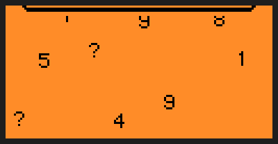
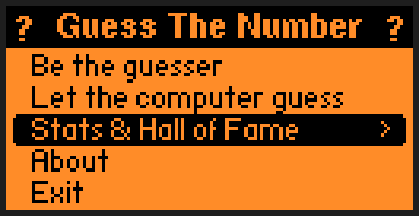
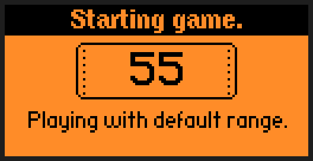
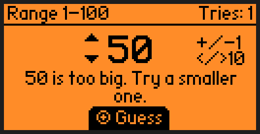
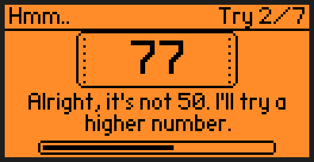
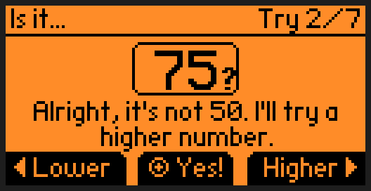
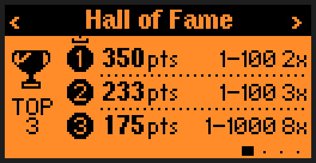
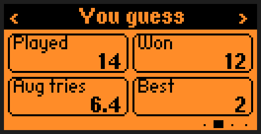
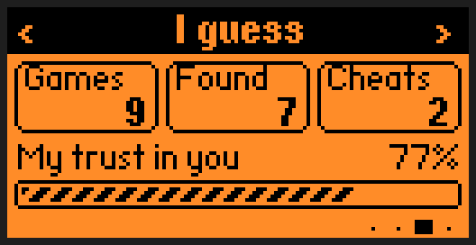
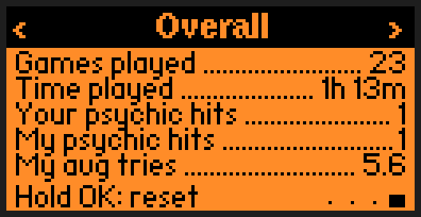

# Guess The Number for Flipper Zero

A tiny number guessing game that started as a Python script in my terminal and grew up into a full Flipper Zero app, with animations, a Hall of Fame and a computer that pretends to think.



## Features

- **Two modes:** guess the Flipper's secret number, or think of a number and let the Flipper find it with binary search (it tells you up front how many tries it will need at most)
- **Custom ranges** from -999 to 9999, default 1 to 100
- **Cheat detection:** lie to the computer and it will notice
- **Hall of Fame** with your top 3 scores, plus detailed stats for both modes, all saved on the SD card
- **Animations everywhere:** intro, sliding menu, number reels, confetti, a shaking number on wrong guesses, and a butterfly to say goodbye
- **LED and vibration feedback** for wins, wrong guesses and cheating

## Screenshots

| | |
|:-:|:-:|
|  |  |
| Main menu | The secret number is being drawn |
|  |  |
| Your turn: the bouncing arrow shows the way | Winning |
|  |  |
| The computer is thinking | Higher, lower or yes? |
|  |  |
| Hall of Fame | Your stats |
|  |  |
| How much the computer still trusts you | Overall stats |

## Install

1. Download [`bin/guess_the_number.fap`](bin/guess_the_number.fap).
2. Copy it to `SD Card/apps/Games/` on your Flipper with [qFlipper](https://flipperzero.one/update) or the Flipper mobile app.
3. Open it under **Apps → Games → Guess The Number**.

The prebuilt `.fap` is built against Momentum firmware (`mntm-012`, API 87.1). For other firmware, build it yourself (below).

## Controls

| Screen | Controls |
|---|---|
| Menu | ↑ ↓ choose, OK select, Back exit |
| Range | ↑ ↓ pick Min or Max, ← → change (hold for fast), OK start |
| Your turn | ↑ ↓ ±1, ← → ±10 (hold for fast), OK guess |
| Computer's turn | ← lower, → higher, OK correct |
| Stats | ← → switch page, hold OK 1.5 s to reset |
| Anywhere | Hold Back to quit |

## Scoring

Score = `bit_length(range size) × 100 / tries`

100 points means you played as well as a perfect binary search. Fewer tries and bigger ranges score higher, so 2 tries on 1 to 100 gives 350 points. Ranges with fewer than 10 numbers don't enter the Hall of Fame.

Stats are stored in `SD Card/apps_data/guess_the_number/stats.bin`.

## Build it yourself

You need [uFBT](https://github.com/flipperdevices/flipperzero-ufbt):

```sh
pip install ufbt
ufbt update                       # official firmware SDK
# or, for Momentum:
ufbt update --index-url=https://up.momentum-fw.dev/firmware/directory.json

ufbt                              # builds dist/guess_the_number.fap
ufbt launch                       # builds, installs and starts it on a connected Flipper
```

## Project layout

| File | What it does |
|---|---|
| `gtn_game.c` | Game logic and state machine, no Flipper APIs inside |
| `gtn_ui.c` | All screens and animations |
| `guess_the_number.c` | Flipper entry point: input, timing, notifications, saving stats |
| `gtn_qr.h` | QR code for the About screen |
| `original/guess_the_number.py` | The Python game this all started from |

## Where it started

[`original/guess_the_number.py`](original/guess_the_number.py) is the terminal game this app is based on. The texts, the 0.85 s "Starting game..." pause, the 2-second victory pause and the intentionally missing `lower == upper` shortcut all made it over to the Flipper.

## Credits

Made by [Prevo128](https://github.com/Prevo128).
